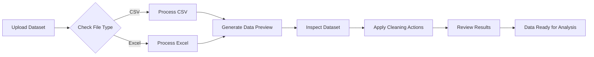
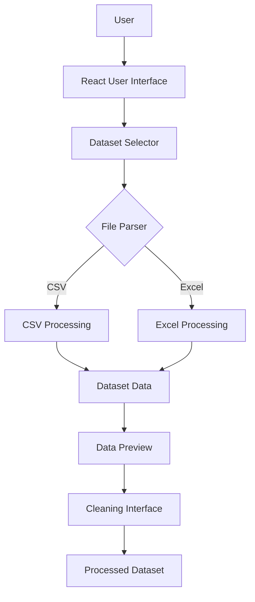
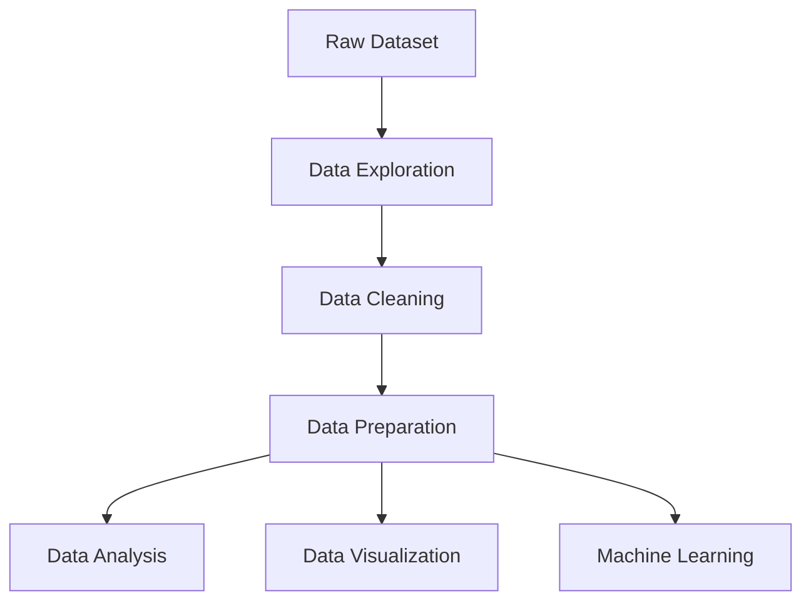

<div align="center">

# 🧹 Data Cleaning Studio

### Transform Raw Data into Clean, Analysis-Ready Insights

A modern and interactive web application designed to upload, explore, clean, and prepare datasets for analysis.


<br>

[About](#-about-the-project) •
[Features](#-key-features) •
[Workflow](#-application-workflow) •
[Tech Stack](#️-technology-stack) •
[Installation](#-getting-started)

</div>

---

## 📌 About the Project

**Data Cleaning Studio** is a modern web application that helps users upload, preview, explore, and prepare datasets through an interactive interface.

The application supports CSV and Excel files and provides an easy workflow for inspecting datasets before using them for data analysis, visualization, or machine-learning projects.

> 🎯 **Goal:** Make raw data easier to understand, organize, and prepare for better insights.

---

## 🔄 Application Workflow



### How It Works

1. **Upload Dataset** — Select a CSV or Excel file.
2. **File Processing** — The application reads and processes the uploaded file.
3. **Data Preview** — View dataset rows, columns, and information.
4. **Data Inspection** — Explore the dataset structure.
5. **Data Cleaning** — Apply the available cleaning operations.
6. **Final Review** — Review the processed dataset.

---

## ✨ Key Features

- 📁 Upload CSV and Excel datasets
- 👀 Preview dataset rows and columns
- 🔎 Explore dataset structure
- 🧹 Perform data-cleaning operations
- 📊 Review processed data
- ⚡ Fast performance with Vite
- 📱 Responsive and modern user interface

---

## 🏗️ Application Architecture



---

## 🛠️ Technology Stack

| Technology | Purpose |
|---|---|
| ⚛️ React | Building the interactive user interface |
| 🔷 TypeScript | Type-safe development |
| ⚡ Vite | Fast development and optimized builds |
| 📄 CSV Processing | Reading and processing CSV datasets |
| 📗 Excel Processing | Reading and processing Excel datasets |
| 🎨 CSS | Styling and responsive design |
| 🎯 Lucide React | Modern interface icons |

---

## 📂 Project Structure

```text
Data-Cleaning/
│
├── assets/
│   └── Images and application resources
│
├── src/
│   │
│   ├── components/
│   │   ├── DatasetSelector.tsx
│   │   └── Other reusable components
│   │
│   ├── data/
│   │   └── Application data
│   │
│   ├── App.tsx
│   └── main.tsx
│
├── .gitignore
├── index.html
├── package.json
├── tsconfig.json
├── vite.config.ts
└── README.md
```

---

## 🚀 Getting Started

### Prerequisites

Install the following:

- Node.js
- npm

Check the installation:

```bash
node -v
npm -v
```

### 1. Clone the Repository

```bash
git clone https://github.com/LakshayTandon02/Data-Cleaning.git
```

### 2. Open the Project Folder

```bash
cd Data-Cleaning
```

### 3. Install Dependencies

```bash
npm install
```

### 4. Start the Development Server

```bash
npm run dev
```

The terminal will show a local URL similar to:

```text
http://localhost:5173/
```

Open the displayed URL in your browser.

---

## 📋 Supported File Formats

| File Type | Extension | Status |
|---|---|---:|
| CSV | `.csv` | ✅ Supported |
| Microsoft Excel | `.xlsx` | ✅ Supported |
| Legacy Excel | `.xls` | ✅ Supported |

---

## 🎯 Use Cases



This project can be useful for:

- 📊 Data analysis projects
- 🤖 Machine-learning dataset preparation
- 🎓 Student and academic projects
- 💼 Business data processing
- 📈 Dashboard data preparation
- 🔎 Dataset exploration
- 🧠 Learning data-preprocessing concepts

---

## 🔮 Future Improvements

- [ ] Missing-value detection
- [ ] Duplicate-row detection and removal
- [ ] Data-type detection
- [ ] Column filtering
- [ ] Data visualizations
- [ ] Outlier detection
- [ ] Download cleaned datasets
- [ ] AI-powered cleaning suggestions
- [ ] Dark and light mode

---

## 👨‍💻 Developer

<div align="center">

### Lakshay Tandon

**Web Developer | Data Science & AI Enthusiast**

[GitHub Profile](https://github.com/LakshayTandon02)

</div>

---

<div align="center">

## 🧹 Clean Data • Better Insights • Smarter Decisions

Made with ❤️ by **Lakshay Tandon**

</div>
