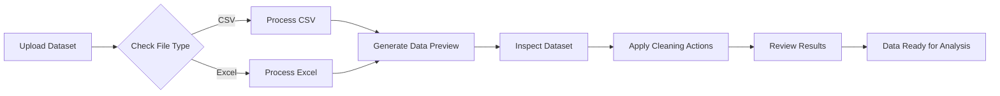
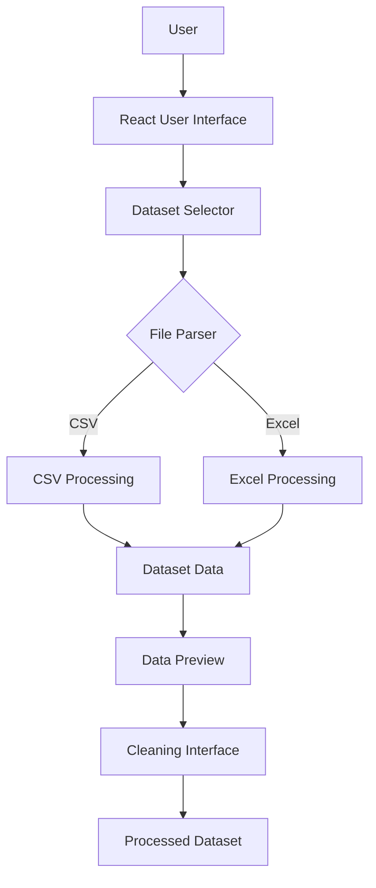
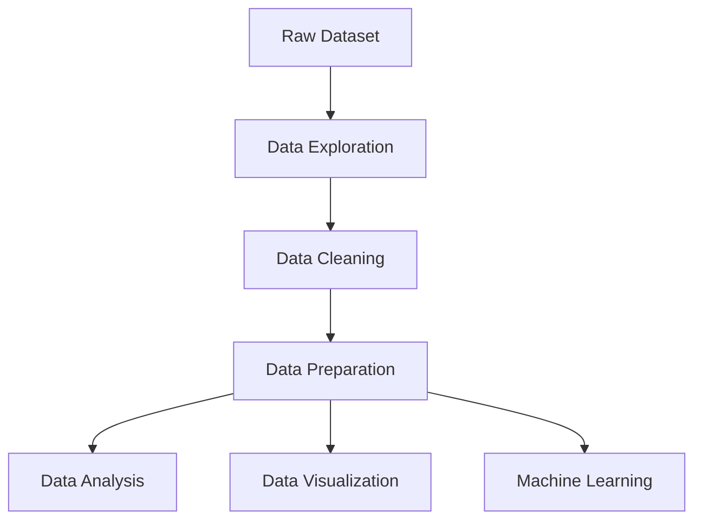

 <div align="center">

# 🧹 Data Cleaning Studio

### Transform Raw Data into Clean, Analysis-Ready Insights

A modern and interactive web application designed to upload, explore, clean, and prepare datasets for analysis.

[](https://data-cleaning-zeta.vercel.app/)


<br>

**[🌐 Live Demo](https://data-cleaning-zeta.vercel.app/)** •
[About](#-about-the-project) •
[Features](#-key-features) •
[Workflow](#-application-workflow) •
[Tech Stack](#️-technology-stack) •
[Installation](#-getting-started)

</div>

---

## 📌 About the Project

**Data Cleaning Studio** is a modern web application that helps users upload, preview, explore, and prepare datasets through an interactive interface.

The application supports CSV and Excel files and provides an easy workflow for inspecting datasets before using them for data analysis, visualization, or machine-learning projects.

🎯 **Goal:** Make raw data easier to understand, organize, and prepare for better insights.

🌐 **Try it now:** [Open Data Cleaning Studio](https://data-cleaning-zeta.vercel.app/)

---

## ✨ Key Features

- 📁 Upload CSV and Excel datasets.
- 👀 Preview dataset rows and columns.
- 🔎 Explore dataset structure.
- 🧹 Perform available data-cleaning operations.
- 📊 Review processed data.
- ⚡ Fast development and build performance with Vite.
- 📱 Responsive and modern user interface.
- 🔷 Type-safe development using TypeScript.

---

## 🔄 Application Workflow

The application follows a straightforward workflow to help users prepare raw datasets for further analysis.



### How It Works

1. **Upload Dataset** — Select a CSV or Excel file.
2. **File Processing** — Read and process the uploaded file.
3. **Data Preview** — View the dataset's rows and columns.
4. **Data Inspection** — Explore the dataset structure.
5. **Data Cleaning** — Apply the available cleaning operations.
6. **Final Review** — Review the processed dataset before using it for analysis.

---

## 🏗️ Application Architecture



The application uses a component-based architecture, with React managing the user interface, TypeScript providing type safety, and Vite powering the development environment and production builds.

---

## 🛠️ Technology Stack

| Technology | Purpose |
|---|---|
| ⚛️ React 19 | Building the interactive user interface |
| 🔷 TypeScript | Type-safe application development |
| ⚡ Vite | Fast development server and optimized builds |
| 📄 CSV Processing | Reading and processing CSV datasets |
| 📗 Excel Processing | Reading and processing Excel datasets |
| 🎨 CSS | Styling and responsive design |
| 🎯 Lucide React | Modern interface icons |
| ▲ Vercel | Application deployment and hosting |

---

## 📂 Project Structure

```text
Data-Cleaning/
│
├── assets/
│   └── Images and application resources
│
├── src/
│   ├── components/
│   │   ├── DatasetSelector.tsx
│   │   └── Other reusable components
│   │
│   ├── data/
│   │   └── Application data
│   │
│   ├── App.tsx
│   └── main.tsx
│
├── .gitignore
├── index.html
├── package.json
├── tsconfig.json
├── vite.config.ts
└── README.md
```

*Note: The structure above is illustrative. Your actual repository may contain additional files and folders.*

---

## 🚀 Getting Started

Follow these steps to run Data Cleaning Studio locally.

### Prerequisites

Make sure you have the following installed:

- [Node.js](https://nodejs.org/)
- npm (included with Node.js)
- Git

Verify your installation:

```bash
node -v
npm -v
git --version
```

### 1. Clone the Repository

```bash
git clone https://github.com/LakshayTandon02/Data-Cleaning.git
```

### 2. Open the Project Folder

```bash
cd Data-Cleaning
```

### 3. Install Dependencies

```bash
npm install
```

### 4. Start the Development Server

```bash
npm run dev
```

The terminal will display a local URL, usually similar to:

```text
http://localhost:5173/
```

Open the displayed URL in your browser to use the application.

### 5. Create a Production Build

To build the application for production:

```bash
npm run build
```

To preview the production build locally:

```bash
npm run preview
```

---

## 📋 Supported File Formats

| File Type | Extension | Status |
|---|---|---|
| CSV | `.csv` | Supported |
| Microsoft Excel | `.xlsx` | Supported |
| Legacy Excel | `.xls` | Supported |

*File support depends on the file-processing libraries and validation implemented in the application.*

---

## 🎯 Use Cases



Data Cleaning Studio can be useful for:

- 📊 Data analysis projects.
- 🤖 Machine-learning dataset preparation.
- 🎓 Student and academic projects.
- 💼 Business data processing.
- 📈 Dashboard data preparation.
- 🔎 Dataset exploration.
- 🧠 Learning data-preprocessing concepts.

---

## 🔮 Future Improvements

The following enhancements could further improve the application:

- [ ] Missing-value detection and handling.
- [ ] Duplicate-row detection and removal.
- [ ] Automatic data-type detection.
- [ ] Column filtering and selection.
- [ ] Interactive data visualizations.
- [ ] Outlier detection.
- [ ] Download cleaned datasets.
- [ ] AI-powered data-cleaning suggestions.
- [ ] Dark and light themes.
- [ ] Data-quality summary and validation reports.
- [ ] Undo and redo cleaning operations.
- [ ] Cleaning history and operation logs.

---

## 🌐 Live Deployment

The application is deployed on Vercel and can be accessed directly through your browser.

**🚀 [Launch Data Cleaning Studio](https://data-cleaning-zeta.vercel.app/)**

No local installation is required to access the deployed version.

---

## 👨‍💻 Developer

<div align="center">

### Lakshay Tandon

**Web Developer | Data Science & AI Enthusiast**

Passionate about building modern web applications and exploring the intersection of data, technology, and artificial intelligence.

[](https://github.com/LakshayTandon02)

[Explore My GitHub Projects](https://github.com/LakshayTandon02)

</div>

---

## 🤝 Contributions

Suggestions, ideas, and contributions are welcome.

If you have an idea to improve Data Cleaning Studio, feel free to open an issue or submit a pull request on GitHub.

---

## 📄 License

No license has been specified yet. Consider adding a `LICENSE` file if you want others to use, modify, or distribute this project under defined terms.

---

<div align="center">

## 🧹 Clean Data • Better Insights • Smarter Decisions

**[🚀 Try Data Cleaning Studio](https://data-cleaning-zeta.vercel.app/)**

Made with ❤️ by **Lakshay Tandon**

</div>
